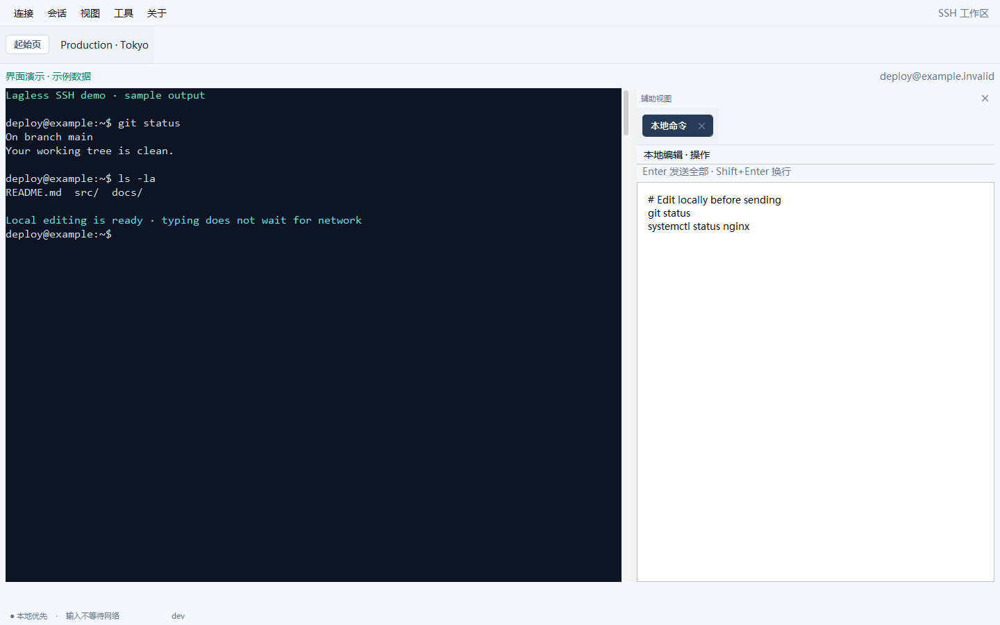
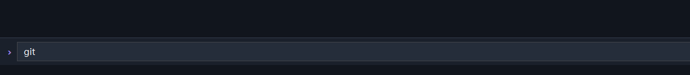
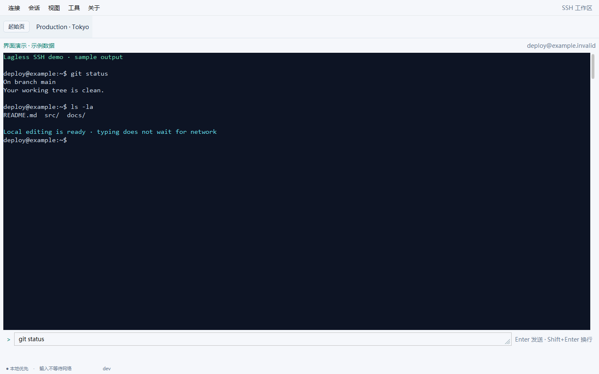
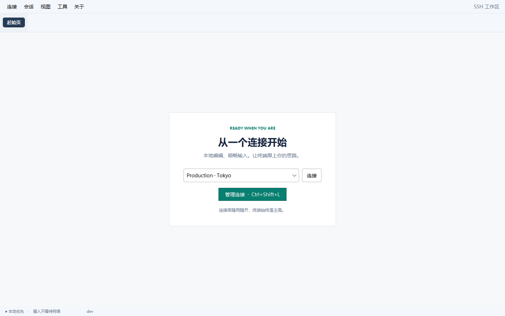
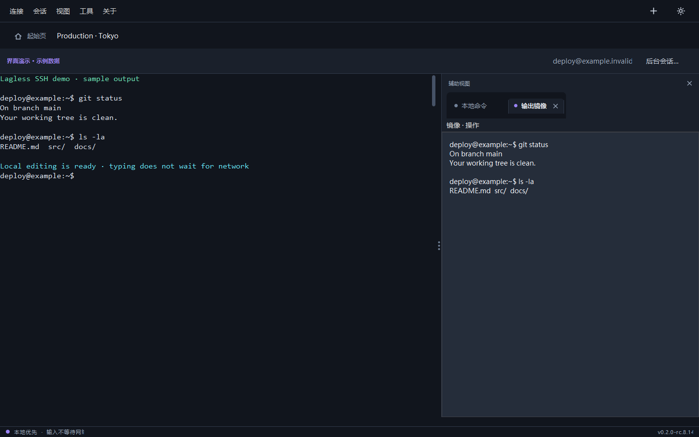

# Lagless SSH

**Keep typing when the network cannot keep up.** Lagless makes SSH feel responsive on slow or unstable connections by letting you write commands locally while SSH communication happens in the background. Use it in your existing terminal or in the desktop app. Nothing needs to be installed on the SSH server.

[简体中文](README.zh-CN.md) · [Download](https://github.com/a1473838623/lagless-ssh/releases/tag/v0.2.0-rc.8.17) · [Desktop guide](docs/desktop.md) · [Terminal/core guide](docs/core.md) · [Plugin guide](docs/plugins.md) · [LINUX DO](https://linux.do/)

  

## Why Lagless?

Imagine working on a server over a congested Wi-Fi connection or a distant network. In a regular SSH session, the server echoes what you type. When that echo is delayed, even fixing a typo can feel like fighting the cursor.

Lagless separates **your typing from the network wait**. It shows the command you are writing immediately on your own computer, so moving the cursor, editing text, and browsing command history stay smooth. Press Enter when the command is ready; Lagless then sends the complete line over SSH. It also fetches completion suggestions in the background, without making you stop typing to wait for them. This is the key idea behind its asynchronous SSH workflow: a slow connection can delay the remote result, but it does not have to delay your next keystroke.

The remote command still needs a working connection to run and return output. Programs that need individual keys, such as `vim`, can receive them directly, so their response still depends on network latency.



*The gallery is rendered from the actual desktop UI with sample `example.invalid` hosts and sample output. It is not a live SSH session.*

## Highlights

- **Responsive input over slow links.** Write and revise commands locally; SSH sends the finished line when you press Enter, while completion suggestions are fetched in the background.
- **Full-screen, live-updating tools.** Keep working inside Claude Code, Codex CLI, `vim`, and similar programs as they redraw. Claude Code's input line can be edited locally; the desktop editor can send a draft directly to the running program, including Codex CLI. The terminal view handles continuous redraws and scrolling.
- **Your choice of interface.** Use the independent terminal core in a terminal you already like, or open the desktop app for concurrent sessions, files, logs, and optional tools. Neither edition requires software on the server.

| | Terminal edition | Desktop edition |
| --- | --- | --- |
| Local shell editing and history | Yes | Yes |
| Asynchronous completion | Yes | Yes |
| Interactive programs | Claude Code, Codex CLI, and other full-screen tools; local prediction where supported | Live terminal view, direct sending from the local editor, and configurable scrolling |
| SSH jump hosts and SFTP | CLI commands | Connection profiles and file manager |
| Multiple sessions, local editor, logs, AI and plugins | — | Yes |
| Server installation | None | None |

## See it in action

### Type into a local draft

The input below is drawn locally while the SSH session waits. The desktop editor can sit below the terminal, to its right, or in its own window. The terminal edition provides the same latency sensitive core in your existing terminal.



### Explore the workspace



| Connection picker | Output mirror |
| --- | --- |
|  |  |

The [full gallery](docs/gallery.md) includes larger screenshots and explains which parts use sample data. A [share kit](docs/launch-kit.md) has short English and Chinese introductions and a social preview image.

## Download and start

**Current release: [v0.2.0-rc.8.17](https://github.com/a1473838623/lagless-ssh/releases/tag/v0.2.0-rc.8.17), a pre-release.** It contains both desktop and terminal-only downloads. A stable public 0.2 release has not been declared yet.

| Your setup | Asset to download | Start |
| --- | --- | --- |
| Windows x64, native desktop | `lagless-desktop-native-0.2.0-rc.8.17-windows-x64.zip` | Extract the full ZIP; run `Lagless.exe` |
| Windows x64, desktop with bundled runtime | `lagless-0.2.0-rc.8.17-windows-x64.zip` | Extract and run `lagless.cmd gui` |
| Windows x64, terminal only | `lagless-terminal-0.2.0-rc.8.17-windows-x64.zip` | Extract and run `lagless.cmd user@host` |
| Java 21+ already installed | `lagless.jar` (desktop) or `lagless-terminal.jar` | See [install details](docs/core.md) |

rc.8.17 publishes Windows packages only. On Linux or macOS, use `lagless.jar` or `lagless-terminal.jar` with Java 21+, or the bundled-runtime ZIPs of [rc.8.16](https://github.com/a1473838623/lagless-ssh/releases/tag/v0.2.0-rc.8.16). Use the asset matching your platform and architecture. Download `SHA256SUMS.txt` from the release to verify the assets. The Windows native package does not require a separate Java installation.

```bash
# SSH target, or a Host alias from ~/.ssh/config
lagless user@example.com
lagless myserver

# Browse configured hosts
lagless
```

Lagless reads your existing `~/.ssh/config`, keys, and known hosts. The desktop connection library can import terminal profiles; it does not need an empty second account list. Passwords and unknown host fingerprints are requested when connecting.

## What the desktop adds

- **Workspace:** concurrent SSH tabs, multiple windows, a connection picker, and a local editor that preserves drafts.
- **Files and history:** two pane SFTP browser with a transfer queue, progress, file and folder operations; persistent terminal history, full SSH transcript, and application run log with an in-app viewer and export.
- **Resilience:** reconnect with backoff and preserve local drafts. If the server already has `tmux`, Lagless can reattach to it after a disconnect. An SSH client alone cannot preserve a remote PTY after the connection is lost.
- **Jump hosts:** use another SSH profile as a background jump connection. The target sees the jump host's address; this does not make the user anonymous to the jump host or network provider.
- **Optional assistance:** editable output mirror, AI assistant and translation, command review, and local plugins. AI requests require an explicitly configured service; [plugin development guide](docs/plugins.md).
- **Portability:** profile import/export, encrypted backups, restore, and update/rollback controls.

See the [desktop feature guide and limitations](docs/desktop.md). Some desktop behavior remains under active validation, so the 0.2 line is marked pre-release.

## Build from source

Requires JDK 21+ and Maven. Build the terminal edition alone, or both editions:

```bash
mvn -pl cli -am -DskipTests package
mvn -DskipTests package
```

The outputs are `cli/target/lagless-cli-standalone.jar` and `desktop/target/lagless-desktop-standalone.jar`. Platform bundles and Native Image builds are described in [desktop packaging](docs/native-image.md). GitHub Actions are currently paused to conserve the project's Actions quota; a passing badge would be misleading, so this README does not show one.

## Help this project grow

If Lagless makes a slow connection usable, **[star the repository](https://github.com/a1473838623/lagless-ssh)** so other developers can find it. The most useful next step is a reproducible issue: tell us your operating system, terminal, remote shell, latency, and the exact interaction that felt slow or broke. Screenshots and short recordings are welcome after removing hostnames, credentials, and session secrets.

Share the project with people who administer servers over distant or unreliable links. Contributions and documentation fixes are welcome; start with [CONTRIBUTING.md](CONTRIBUTING.md). See the [release history](CHANGELOG.md) for the current desktop preview and the stable terminal line.

Lagless SSH recognizes the [LINUX DO community](https://linux.do/) and appreciates its support for open-source projects and technical exchange.

## License

Lagless SSH is licensed under [Apache License 2.0](LICENSE). Third-party dependencies retain their own licenses.
