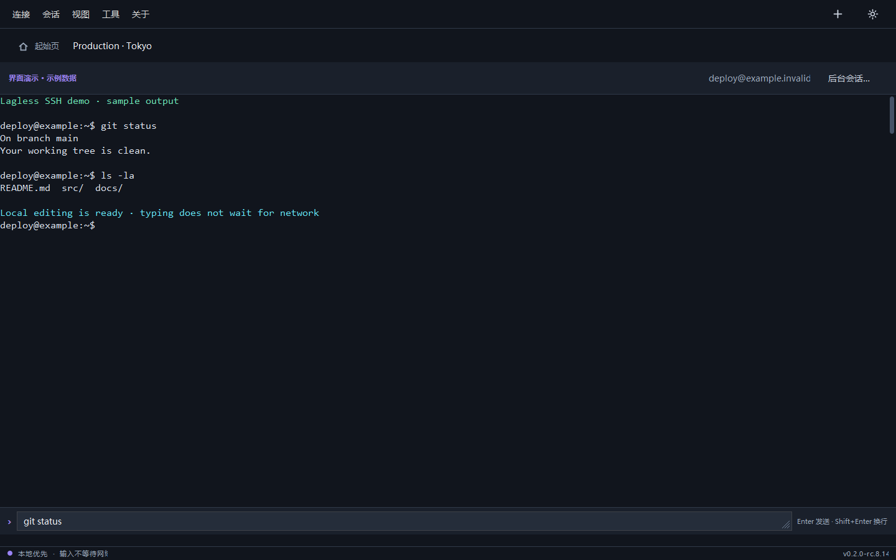
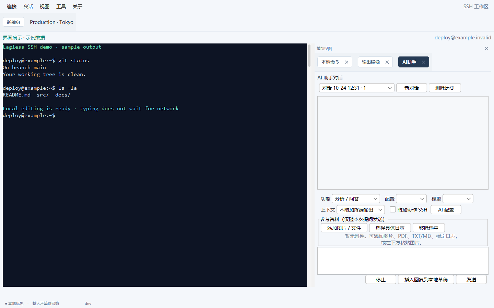
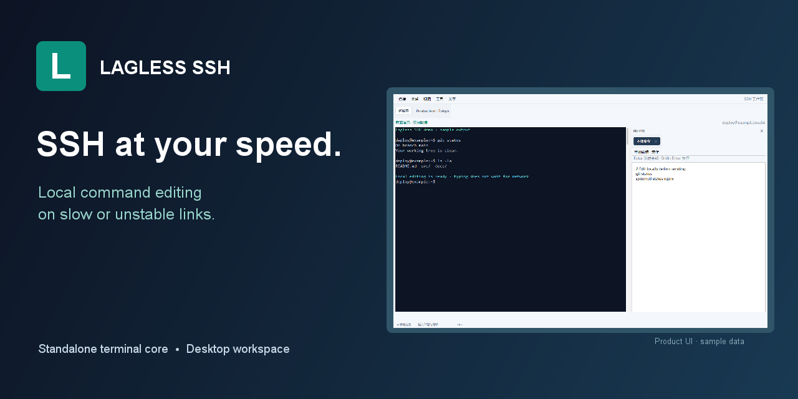

# Lagless UI gallery / 界面演示

[English](../README.md) · [简体中文](../README.zh-CN.md)

These images are rendered from the product's Swing components with sample `example.invalid` hosts and sample output. They show the UI layout and controls without opening a network connection. The GIFs are assembled from those rendered frames. 中文：以下图片由真实界面组件和示例数据生成，没有连接真实服务器。

## Workspace tour / 工作区导览

## Local editing / 本地命令编辑

## Connection picker / 连接选择

## Output mirror / 输出镜像

## Optional AI assistant / 可选 AI 助手

The AI panel is shown before a service is configured; no AI response is invented in the image. / AI 面板截图中尚未配置服务，也未伪造 AI 回答。

## Share card / 分享封面

The card uses the same sample-data screenshot. It is sized for repository social previews and launch posts. / 分享封面使用同一张示例截图，可用于项目社交预览和发布帖。

## Refresh the gallery / 重新生成图片

On Windows with JDK 21+ and Maven, run `./scripts/generate-gallery.ps1`. It builds without running tests, then renders the media above. The renderer uses a temporary Lagless home and a compatibility paint path so terminal text is included in offscreen captures. It does not access saved user connections.
